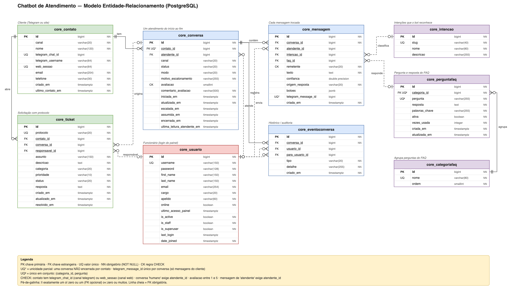
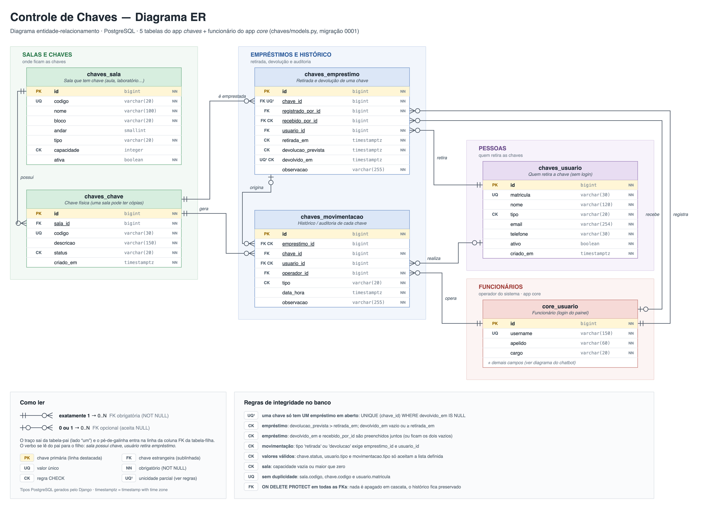

# Chatbot de Atendimento

Protótipo de **atendimento ao cliente com chatbot**, feito como projeto de estágio.

O cliente fala com o bot do Telegram **@felipeprojeto_bot** ou com o chat do site. O bot responde dúvidas pelo **FAQ** e pela **IA (Google Gemini)**, abre **tickets** com protocolo e, quando o cliente pede, passa a conversa para uma **fila de atendentes humanos**. Vários funcionários, cada um com seu login, assumem e respondem as conversas pelo **painel web**, e a resposta chega ao cliente pelo mesmo bot.

Stack: **Python 3.12 · Django 5.2 · PostgreSQL** (Neon em produção) · **Vercel** · API de Bots do Telegram · Gemini.

---

## Arquitetura

```
   Cliente                                                    Funcionários (vários logins)
 ┌──────────────┐                                            ┌───────────────────────────┐
 │  Telegram    │                                            │ Painel web  /painel/      │
 │ @felipeprojeto_bot                                        │ fila · conversa · tickets │
 └──────┬───────┘                                            │ dashboard · FAQ · equipe  │
        │ webhook HTTPS (/telegram/webhook/)                 └────────────┬──────────────┘
        ▼                                                                 │ HTTP (polling JSON)
 ┌─────────────────────────────────────────────────────────────────────────▼─────────────┐
 │                         Django (uma Vercel Function)                                  │
 │                                                                                       │
 │   bot/      motor do bot: menu, FAQ, NLP, Gemini, envio ao Telegram                   │
 │   webchat/  site: página inicial, /chat/ (mesmo motor do bot), /saude/                │
 │   painel/   site dos funcionários                                                     │
 │   core/     MODELOS (banco) + services.py = regras de atendimento num lugar só        │
 └──────────┬───────────────────────────────────────────────┬────────────────────────────┘
            │ SQL (psycopg)                                  │ HTTPS
            ▼                                                ▼
 ┌──────────────────────────┐                     ┌──────────────────────────┐
 │ PostgreSQL (Neon)        │                     │ Google Gemini (IA)       │
 │ 9 tabelas core_*         │                     │ intenção + resposta      │
 └──────────────────────────┘                     └──────────────────────────┘
        ▲
        │ chat do site (navegador do visitante, polling JSON)
 ┌──────┴───────┐
 │ Visitante    │
 │ do site      │
 └──────────────┘
```

Fluxo de um atendimento humano:

```
Cliente: "quero falar com atendente"  →  bot: escalar()  →  status = fila
Painel de TODOS os funcionários mostra a conversa na fila
Ana clica "Assumir"  →  assumir() trava a linha (SELECT … FOR UPDATE)  →  status = humano
   (se Beto clicar ao mesmo tempo, recebe "Conversa já está com Ana")
Ana responde no painel  →  services.enviar_ao_cliente()  →  Telegram: "👤 Ana (atendente): …"
Ana encerra  →  status = encerrada  →  bot pede avaliação ⭐ 1–5
```

---

## Funcionalidades × requisitos do estágio

| Requisito | Onde está |
|---|---|
| **Básico: FAQ automatizado** | `core_categoriafaq` / `core_perguntafaq`. O bot responde pelo FAQ (busca por palavras-chave, ou pela IA quando ela está disponível). O FAQ é editado no painel (`/painel/faq/`) |
| **Básico: abertura de tickets** | Menu do bot → "📝 Abrir ticket" gera um protocolo `TCK-0001`; "📋 Meus tickets" consulta o andamento. A equipe trata em `/painel/tickets/`, e o cliente é avisado quando o ticket é resolvido |
| **Básico: escalonamento para humano** | "👤 Falar com atendente", ou o bot não sabe responder → fila → um funcionário assume → transferir / devolver ao bot / encerrar |
| **Básico: relatórios** | Dashboard (`/painel/dashboard/`) e consultas SQL em `docs/consultas-relatorios.sql` |
| **Avançado: identificação de intenção (IA/NLP)** | Gemini classifica a intenção de cada mensagem (`core_intencao`), com confiança de 0 a 1 gravada em `core_mensagem.confianca`. Se a IA estiver fora, entra o fallback por palavras-chave |
| **Avançado: respostas personalizadas** | A IA reescreve a resposta do FAQ em linguagem natural, usando só o que o FAQ diz, sabe o nome do cliente e extrai da conversa os campos do ticket. O atendente aparece com o apelido ("👤 Ana") |
| **Avançado: integração Telegram + Webchat** | O mesmo motor e o mesmo banco atendem os dois canais (`core_contato.canal`). O site tem uma página inicial com QR code do Telegram e o chat em `/chat/` |
| **Avançado: dashboard com satisfação** | Avaliação de 1 a 5 ao encerrar; dashboard com nota média, tempo na fila, intenções e tickets |

Menu do bot: **❓ Chat de dúvida · 💬 Chat de conversa · 📝 Abrir ticket · 📋 Meus tickets · 👤 Falar com atendente**.

Painel: **fila** (assumir), **conversa** (responder, transferir, devolver ao bot, encerrar), **tickets**, **dashboard**, **FAQ** e **funcionários** (só o supervisor). Há também o `/admin/` do Django, para conferir os dados do banco, e `/saude/`, que verifica se o app e o banco estão de pé.

> Os apps `bot/`, `painel/` e `webchat/` estão em desenvolvimento. A lista acima descreve o escopo planejado e implementado nesses apps.

---

## Estrutura de pastas

```
chatbot-atendimento/
├── config/            settings.py (lê o .env), urls.py, wsgi.py (entrada da Vercel)
├── core/              BANCO DE DADOS
│   ├── models.py        9 tabelas + constraints
│   ├── services.py      regras: escalar, assumir, transferir, encerrar, tickets…
│   ├── admin.py         /admin/ completo
│   ├── tests.py         29 testes de banco e regras (105 no projeto todo)
│   ├── migrations/      criação das tabelas
│   └── management/commands/popular_demo.py   dados de teste
├── bot/               motor do bot, Telegram, Gemini, comandos telegram_polling / telegram_webhook
├── painel/            site dos funcionários
├── webchat/           página inicial + chat do site
├── docs/              diagrama ER (draw.io/SVG/PNG), dicionário de dados, schema.sql, consultas
├── requirements.txt   dependências
├── .python-version    3.12 (lido pela Vercel)
├── vercel.json        configuração da função na Vercel
└── .env.example       modelo das variáveis de ambiente
```

---

## Rodar local em 3 passos

Pré-requisitos: Python 3.12 e, opcionalmente, PostgreSQL. Sem PostgreSQL, o projeto usa SQLite automaticamente.

**1. Instalar**

```bash
# com uv (mais rápido)
uv venv --python 3.12 && uv pip install -r requirements.txt
# ou com pip
python3.12 -m venv .venv && source .venv/bin/activate && pip install -r requirements.txt
```

**2. Configurar**

```bash
cp .env.example .env
# edite o .env: TELEGRAM_BOT_TOKEN, GEMINI_API_KEY e, se quiser PostgreSQL:
createdb chatbot_atendimento
# DATABASE_URL=postgres://localhost/chatbot_atendimento
```

**3. Banco + servidor**

```bash
source .venv/bin/activate
python manage.py migrate
python manage.py popular_demo --conversas   # funcionários, FAQ, intenções + 40 conversas fictícias
python manage.py runserver                  # http://127.0.0.1:8000
```

Para o bot do Telegram responder localmente, rode em **outro terminal**:

```bash
python manage.py telegram_polling
```

Ele busca as mensagens no Telegram (long polling), sem precisar de URL pública. **Atenção:** o comando apaga o webhook. Depois, para voltar a produção, rode de novo o `telegram_webhook --url …` (veja o deploy abaixo).

### Usuários de teste

| Login | Senha | Cargo |
|---|---|---|
| `supervisor` | `teste123` | Supervisor (dashboard, funcionários, /admin/) |
| `atendente1` | `teste123` | Atendente |
| `atendente2` | `teste123` | Atendente |

Para testar vários atendentes ao mesmo tempo, abra uma janela anônima ou outro navegador para cada login.

### Testes

```bash
python manage.py test core                  # contra o PostgreSQL do .env
DATABASE_URL= python manage.py test core    # contra SQLite
```

---

## Deploy: Vercel + Neon

A Vercel hoje **detecta Django sozinha**: acha o `manage.py`, lê `WSGI_APPLICATION = "config.wsgi.application"` e transforma o app numa Vercel Function. Não precisa de `api/index.py`. Os arquivos de deploy deste repositório são:

- `.python-version` com `3.12`;
- `requirements.txt` com as dependências;
- `vercel.json`, que dá até 60 s por requisição (a chamada ao Gemini pode demorar) e tira `docs/` e os testes do pacote;
- `.vercelignore`, que não envia `.venv`, `.env` nem o SQLite.

**Deploy automático:** o projeto na Vercel está ligado a este repositório. Todo `git push` na branch `master` publica uma nova versão em produção em cerca de 1 minuto; pushes em outras branches geram um link de pré-visualização.

**Arquivos estáticos (CSS/JS):** a Vercel roda o `collectstatic` automaticamente no build, porque `STATIC_ROOT` está configurado, e serve os arquivos pela CDN. O WhiteNoise com `WHITENOISE_USE_FINDERS = True` serve como garantia e funciona mesmo sem `collectstatic`. Não é preciso configurar nada.

### Passo a passo

1. **Subir o código para o GitHub** (sem o `.env`, que já está no `.gitignore`).
2. **Importar na Vercel:** https://vercel.com/new → escolher o repositório → Framework Preset **Django** (detectado). Ainda não clique em Deploy.
3. **Criar o banco Neon:** no projeto da Vercel, *Storage → Create Database → Neon* (Marketplace) e conectar ao projeto. A integração cria sozinha as variáveis **`DATABASE_URL`** (conexão *pooled*), **`DATABASE_URL_UNPOOLED`** (conexão direta), `PG*` e as legadas `POSTGRES_*`. O `settings.py` lê `DATABASE_URL` (ou `POSTGRES_URL`), exige `sslmode=require` em produção e desliga os cursores do lado do servidor quando a conexão é *pooled*.
4. **Variáveis de ambiente** (*Settings → Environment Variables*, ambiente Production):

   | Variável | Valor |
   |---|---|
   | `DJANGO_SECRET_KEY` | chave longa aleatória: `python -c "import secrets; print(secrets.token_urlsafe(50))"` |
   | `DJANGO_DEBUG` | `false` |
   | `TELEGRAM_BOT_TOKEN` | token do @BotFather |
   | `TELEGRAM_BOT_USERNAME` | `felipeprojeto_bot` |
   | `TELEGRAM_WEBHOOK_SECRET` | texto aleatório (o Telegram o envia em cada webhook) |
   | `GEMINI_API_KEY` | chave do https://aistudio.google.com |
   | `GEMINI_MODEL` | `gemini-flash-lite-latest` |
   | `NOME_EMPRESA` | `Empresa Teste` |
   | `DATABASE_URL` | *criada pela integração Neon, não mexa* |

   `DJANGO_ALLOWED_HOSTS` e `DJANGO_CSRF_TRUSTED_ORIGINS` já aceitam `*.vercel.app` por padrão. Só defina essas duas se usar domínio próprio.
5. **Deploy:** clique em *Deploy* (ou rode `vercel deploy --prod` com a CLI).
6. **Criar as tabelas no Neon, da sua máquina.** As migrations **não** rodam no build. Copie a `DATABASE_URL_UNPOOLED` (*Storage → Neon → .env.local*, ou `vercel env pull`) e rode:

   ```bash
   DATABASE_URL='postgresql://…neon.tech/neondb?sslmode=require' python manage.py migrate
   DATABASE_URL='postgresql://…neon.tech/neondb?sslmode=require' python manage.py popular_demo
   ```

   Use a conexão *unpooled* (direta) para migrations. Acrescente `--conversas` se quiser dados fictícios no dashboard da apresentação.
7. **Ligar o webhook do Telegram** (da sua máquina, com o `TELEGRAM_BOT_TOKEN` no `.env`):

   ```bash
   python manage.py telegram_webhook --url https://SEU-APP.vercel.app/telegram/webhook/
   python manage.py telegram_webhook --info     # confere
   ```
8. **Testar:** `https://SEU-APP.vercel.app/saude/` deve responder OK. Depois, mande `/start` para o bot e entre em `/painel/` com `atendente1`.

**Opcional: migrate automático no build.** É possível definir *Settings → Build & Development → Build Command* = `python manage.py migrate --noinput`. **Não recomendamos** neste projeto, por dois motivos: (a) um Build Command próprio substitui o build padrão do Django na Vercel, e (b) os deploys de *preview* (cada push em outra branch) também migrariam o banco de produção, a não ser que você ative os *preview branches* do Neon. Rodar o `migrate` da máquina local é simples e controlado.

---

## Banco de dados

Documentação completa em [`docs/modelo-de-dados.md`](docs/modelo-de-dados.md):

- **Diagrama ER:** [`docs/diagrama-er.drawio`](docs/diagrama-er.drawio), para abrir em https://app.diagrams.net. Também em imagem: [`docs/diagrama-er.png`](docs/diagrama-er.png) e [`.svg`](docs/diagrama-er.svg).
- **Dicionário de dados:** objetivo, colunas, tipos, PK/FK/UQ de cada tabela.
- **Regras de integridade:** cada constraint, por que existe e que bug evita.
- **Ciclo de vida da conversa:** bot → fila → humano → encerrada.
- **Consultas de relatório** testadas: [`docs/consultas-relatorios.sql`](docs/consultas-relatorios.sql).
- **DDL real:** [`docs/schema.sql`](docs/schema.sql).
- **Prova das constraints no psql:** [`docs/testes-integridade.sql`](docs/testes-integridade.sql).



---

## Controle de chaves

Módulo do mesmo projeto (app `chaves`) para controlar o empréstimo das chaves das salas. Ele cobre as entidades **Usuário, Sala, Chave, Empréstimo e Movimentação**. Usa o mesmo login do painel, e o funcionário logado fica registrado como operador de cada operação.

- **Telas** (menu "Controle de chaves" no painel):
  - `/painel/chaves/`: visão geral, com contadores (disponíveis, emprestadas, atrasadas), lista de chaves, emprestar e devolver.
  - `/painel/chaves/emprestimos/`: empréstimos em aberto, atrasados e devolvidos.
  - `/painel/chaves/salas/` e `/painel/chaves/usuarios/`: cadastros.
  - `/painel/chaves/movimentacoes/`: histórico completo, que não pode ser editado.
- **Dados de exemplo:** `python manage.py popular_chaves --historico` cria salas, chaves e usuários de teste, além de empréstimos passados e em aberto (inclusive um atrasado).
- **Documentação de dados:**
  - [`docs/modelo-de-dados-chaves.md`](docs/modelo-de-dados-chaves.md): entidades, campos, PK/FK/obrigatórios, relacionamentos e regras.
  - Diagrama ER: [`docs/diagrama-er-chaves.drawio`](docs/diagrama-er-chaves.drawio), também em [`.png`](docs/diagrama-er-chaves.png) e [`.svg`](docs/diagrama-er-chaves.svg).
  - DDL: [`docs/schema-chaves.sql`](docs/schema-chaves.sql).



---

## Roteiro de apresentação (5 min)

| Tempo | O que mostrar | Mensagem |
|---|---|---|
| 0:00–0:40 | Slide com o diagrama de arquitetura (acima) | "Um bot, dois canais (Telegram e site), vários atendentes, um banco PostgreSQL." |
| 0:40–1:50 | **Telegram ao vivo:** `/start` → "❓ Chat de dúvida" → "como pago com pix?" (o FAQ/IA responde) → "📝 Abrir ticket" (recebe `TCK-…`) | Atendimento automático e protocolo |
| 1:50–3:00 | No Telegram, "👤 Falar com atendente". No painel com **dois navegadores** (atendente1 e atendente2), a conversa aparece na fila dos dois. Um clica "Assumir"; o outro tenta e recebe o aviso. Responder → a mensagem chega no Telegram com o nome do atendente. Encerrar → o cliente dá ⭐⭐⭐⭐⭐ | Escalonamento humano, vários funcionários, sem conflito |
| 3:00–4:20 | **Banco de dados:** abrir `docs/diagrama-er.png` (9 tabelas, PK/FK, 1:N). Mostrar 2 regras: "1 conversa aberta por cliente" e "não duplicar mensagem do Telegram". No terminal, `psql -f docs/testes-integridade.sql` (o banco recusando) e uma consulta (nota média por atendente) | Modelagem, chaves, integridade, consultas: entrega do squad de dados |
| 4:20–5:00 | Dashboard (`/painel/dashboard/`): satisfação, intenções, tempo na fila. Fechar com `python manage.py test` → 105 testes OK | Relatórios + qualidade |

Dica: rode `popular_demo --conversas` antes, para o dashboard ter dados. Deixe o painel já logado nos dois navegadores.
