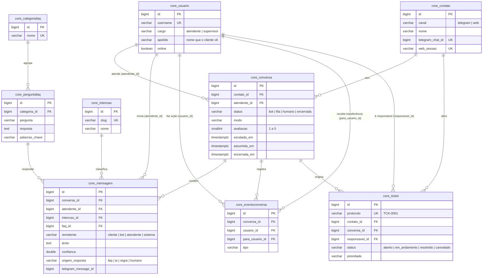

# Modelo de dados: Chatbot de Atendimento

Banco: **PostgreSQL** (Neon em produção, PostgreSQL local em desenvolvimento). As tabelas são criadas pelas migrations do Django a partir de `core/models.py`.

| Arquivo | O que é |
|---|---|
| `docs/diagrama-er.drawio` | Diagrama ER editável (abrir em https://app.diagrams.net → *File › Open from › Device*) |
| `docs/diagrama-er.svg` / `.png` | O mesmo diagrama em imagem, para colar em slides |
| `docs/schema.sql` | DDL real gerado pelo Django (`sqlmigrate`) |
| `docs/consultas-relatorios.sql` | Consultas de relatório desta página, prontas para rodar |
| `docs/testes-integridade.sql` | Script que tenta gravar dados inválidos e mostra o banco recusando |
| `core/tests.py` | Testes automáticos das regras (`python manage.py test core`) |

---

## 1. Visão geral

São 9 tabelas, em 4 grupos (as cores são as mesmas do diagrama):

| Grupo | Tabelas | Para quê |
|---|---|---|
| Funcionários (vermelho) | `core_usuario` | Login do painel: atendentes e supervisor |
| Clientes (verde) | `core_contato`, `core_ticket` | Quem fala com o bot e as solicitações que abriu |
| Atendimento (azul) | `core_conversa`, `core_mensagem`, `core_eventoconversa` | A conversa, cada mensagem e o histórico de ações |
| Base de conhecimento (roxo) | `core_intencao`, `core_categoriafaq`, `core_perguntafaq` | O que o bot sabe reconhecer e responder |



**Como ler o pé-de-galinha:** `||` = exatamente um; `o|` = zero ou um; `o{` = zero ou muitos. Exemplo: `core_contato ||--o{ core_conversa` quer dizer que cada conversa pertence a exatamente um contato, e um contato pode ter zero ou muitas conversas.

### Decisões de modelagem (para explicar na apresentação)

1. **Toda tabela tem `id bigint` auto-incremento como PK** (chave substituta). Os identificadores "naturais", como o `chat_id` do Telegram ou o protocolo, ficam em colunas com **UNIQUE**. Assim a PK nunca muda e as FKs ficam pequenas e rápidas.
2. **Cliente (`contato`) e funcionário (`usuario`) ficam em tabelas separadas.** O cliente não tem senha nem login, e o funcionário tem. O Django já traz pronta a tabela de usuários com senha criptografada, e nós só acrescentamos `cargo`, `apelido` e `online`.
3. **A conversa é o centro do modelo.** Ela tem um *status* (máquina de estados, ver seção 4) e guarda os momentos-chave (`escalada_em`, `assumida_em`, `encerrada_em`), o que deixa as métricas fáceis de calcular.
4. **Toda mensagem é gravada, inclusive as do bot.** Com isso dá para auditar o que a IA respondeu, medir o uso do FAQ e montar relatórios por intenção.
5. **`eventoconversa` é uma trilha de auditoria** (quem assumiu, transferiu, devolveu ou encerrou, e quando). Ela não é editada: só recebe linhas novas.
6. **As regras de integridade ficam no banco** (UNIQUE, CHECK, índices únicos parciais), e não só no Python. Mesmo que um bug no código ou duas requisições simultâneas tentem gravar algo errado, o PostgreSQL recusa.
7. **Valores de lista** (status, canal, prioridade…) são `varchar` com as opções definidas no código (`TextChoices`). Ficam legíveis no SQL (`status = 'fila'`), e acrescentar uma opção não exige migration de tipo.

---

## 2. Dicionário de dados

Convenções: **NN** = NOT NULL (obrigatório). Textos opcionais são NOT NULL com valor vazio `''` (padrão do Django). Os campos que de fato podem ficar "sem valor" (datas, números, FKs opcionais) aceitam `NULL`. `timestamptz` = data e hora com fuso, gravadas em UTC.

### 2.1 `core_usuario`: funcionários

**Objetivo:** login no painel. Cada linha é um atendente ou supervisor. A tabela herda os campos padrão do Django (`AbstractUser`).

| Coluna | Tipo | NN | Descrição |
|---|---|---|---|
| id | bigint | PK | Identificador |
| username | varchar(150) | sim, **UQ** | Login (ex.: `atendente1`) |
| password | varchar(128) | sim | Hash da senha (PBKDF2). A senha nunca é gravada em texto puro |
| first_name / last_name | varchar(150) | sim | Nome |
| email | varchar(254) | sim | E-mail (pode ser vazio) |
| cargo | varchar(20) | sim | `atendente` ou `supervisor` (o supervisor vê dashboard e gerencia funcionários) |
| apelido | varchar(60) | sim | Nome que o cliente vê no Telegram ("👤 Ana (atendente)") |
| online | boolean | sim | Disponível para receber conversas |
| ultimo_acesso_painel | timestamptz | não | Última atividade no painel |
| is_active / is_staff / is_superuser | boolean | sim | Ativo, acessa o /admin/, tem todas as permissões |
| last_login / date_joined | timestamptz | não / sim | Datas do Django |

Tabelas auxiliares do Django: `core_usuario_groups` e `core_usuario_user_permissions` (N:N com grupos e permissões, não usadas pelo projeto).

### 2.2 `core_contato`: clientes

**Objetivo:** quem conversa com o bot, pelo Telegram ou pelo chat do site. Um cliente é cadastrado uma única vez e reaparece em todas as conversas dele.

| Coluna | Tipo | NN | Descrição |
|---|---|---|---|
| id | bigint | PK | Identificador |
| canal | varchar(20) | sim | `telegram` ou `web` |
| nome | varchar(120) | sim | Nome mostrado no painel (vem do perfil do Telegram ou "Visitante do site") |
| telegram_chat_id | bigint | **UQ** | ID do chat no Telegram. É por ele que o bot sabe para quem responder |
| telegram_username | varchar(64) | sim | @usuario do Telegram (pode ser vazio) |
| web_sessao | varchar(64) | **UQ** | Identificador anônimo do visitante do site (guardado na sessão do navegador) |
| email / telefone | varchar | sim | Opcionais |
| criado_em | timestamptz | sim | Primeiro contato |
| ultimo_contato_em | timestamptz | sim | Atualizado a cada mensagem |

Constraints: `UNIQUE(telegram_chat_id)`, `UNIQUE(web_sessao)`, `CHECK contato_identificador_por_canal`.

### 2.3 `core_conversa`: atendimentos

**Objetivo:** um atendimento do começo ao fim. Uma conversa termina quando é encerrada. Se o cliente voltar depois, abre-se uma nova.

| Coluna | Tipo | NN | Descrição |
|---|---|---|---|
| id | bigint | PK | Número da conversa |
| contato_id | bigint | sim, **FK** → core_contato | Cliente |
| atendente_id | bigint | **FK** → core_usuario | Funcionário responsável (vazio enquanto está com o bot ou na fila) |
| canal | varchar(20) | sim | `telegram` ou `web` (copiado do contato, para filtrar sem JOIN) |
| status | varchar(20) | sim | `bot`, `fila`, `humano` ou `encerrada` (ver seção 4). Indexado |
| modo | varchar(20) | sim | Em qual opção do menu o cliente está: `menu`, `duvida`, `conversa` ou `ticket` |
| motivo_escalonamento | varchar(255) | sim | Por que foi para a fila ("Cliente pediu atendente", "IA não soube responder"…) |
| avaliacao | smallint | não | Nota de 1 a 5 dada pelo cliente no fim |
| comentario_avaliacao | varchar(500) | sim | Comentário opcional |
| iniciada_em / atualizada_em | timestamptz | sim | Criação / última atividade (indexado; ordena a lista) |
| escalada_em | timestamptz | não | Entrou na fila |
| assumida_em | timestamptz | não | Um funcionário assumiu |
| encerrada_em | timestamptz | não | Fim |
| ultima_leitura_atendente_em | timestamptz | não | Para calcular mensagens "não lidas" no painel |

Constraints: `uma_conversa_aberta_por_contato` (índice único parcial), `conversa_humano_tem_atendente` (CHECK), `conversa_avaliacao_1_a_5` (CHECK).

### 2.4 `core_mensagem`: mensagens

**Objetivo:** cada mensagem trocada, seja do cliente, do bot, do atendente ou do sistema. É a base dos relatórios de intenção e de uso do FAQ.

| Coluna | Tipo | NN | Descrição |
|---|---|---|---|
| id | bigint | PK | Identificador |
| conversa_id | bigint | sim, **FK** → core_conversa | A que conversa pertence |
| remetente | varchar(20) | sim | `cliente`, `bot`, `atendente` ou `sistema` (avisos automáticos) |
| atendente_id | bigint | **FK** → core_usuario | Quem enviou, quando `remetente = 'atendente'` |
| texto | text | sim | Conteúdo |
| intencao_id | bigint | **FK** → core_intencao | Intenção detectada (mensagens do cliente) |
| confianca | double precision | não | 0 a 1, certeza da classificação |
| origem_resposta | varchar(20) | sim | Como a resposta foi gerada: `faq`, `ia` (Gemini), `regra` ou `humano` |
| faq_id | bigint | **FK** → core_perguntafaq | Pergunta do FAQ usada na resposta |
| botoes | jsonb | não | Botões enviados junto (`[[{"texto","dado"}]]`) |
| telegram_message_id | bigint | não | ID da mensagem no Telegram |
| criada_em | timestamptz | sim | Data e hora (indexado) |

Índices: `msg_conversa_data_idx (conversa_id, criada_em)`, para carregar o histórico de uma conversa em ordem.
Constraints: `mensagem_atendente_identificado` (CHECK), `mensagem_telegram_sem_duplicidade` (índice único parcial).

### 2.5 `core_eventoconversa`: histórico / auditoria

**Objetivo:** registrar *quem fez o quê e quando* na conversa. Serve para a linha do tempo no painel e para as métricas.

| Coluna | Tipo | NN | Descrição |
|---|---|---|---|
| id | bigint | PK | Identificador |
| conversa_id | bigint | sim, **FK** → core_conversa | Conversa |
| tipo | varchar(20) | sim | `criada`, `escalada`, `assumida`, `transferida`, `devolvida_bot`, `encerrada`, `avaliada` ou `ticket` |
| usuario_id | bigint | **FK** → core_usuario | Funcionário que fez a ação (vazio = cliente/bot) |
| para_usuario_id | bigint | **FK** → core_usuario | Destino de uma transferência |
| detalhe | varchar(255) | sim | Texto livre (motivo, protocolo do ticket, nota…) |
| criado_em | timestamptz | sim | Quando |

Duas FKs para a mesma tabela (`usuario_id` e `para_usuario_id`) é o padrão para registrar uma transferência "de → para".

### 2.6 `core_ticket`: solicitações

**Objetivo:** pedido que não se resolve na hora (reembolso, erro no sistema…). O cliente recebe um protocolo e pode consultar o andamento pelo bot.

| Coluna | Tipo | NN | Descrição |
|---|---|---|---|
| id | bigint | PK | Identificador |
| protocolo | varchar(20) | sim, **UQ** | `TCK-0001`, `TCK-0002`… (gerado automaticamente) |
| contato_id | bigint | sim, **FK** → core_contato | Cliente que abriu |
| conversa_id | bigint | **FK** → core_conversa | Conversa em que foi aberto (opcional) |
| responsavel_id | bigint | **FK** → core_usuario | Funcionário que está cuidando |
| assunto | varchar(150) | sim | Resumo |
| descricao | text | sim | Detalhes |
| categoria | varchar(20) | sim | `duvida`, `suporte`, `financeiro`, `reclamacao` ou `outro` |
| prioridade | varchar(10) | sim | `baixa`, `media` ou `alta` |
| status | varchar(20) | sim | `aberto`, `em_andamento`, `resolvido` ou `cancelado` (indexado) |
| resposta | text | sim | Solução informada ao cliente |
| criado_em / atualizado_em | timestamptz | sim | Datas |
| resolvido_em | timestamptz | não | Preenchido quando o status vira `resolvido` |

### 2.7 `core_intencao`: intenções

**Objetivo:** catálogo do que o bot reconhece numa mensagem (NLP com o Gemini, ou palavras-chave quando a IA está fora).

| Coluna | Tipo | NN | Descrição |
|---|---|---|---|
| id | bigint | PK | |
| slug | varchar(40) | sim, **UQ** | Código usado pelo código e pela IA: `duvida`, `suporte`, `financeiro`, `falar_humano`… |
| nome | varchar(80) | sim | Nome amigável para relatórios |
| descricao | varchar(255) | sim | Exemplo / explicação |

### 2.8 `core_categoriafaq` e 2.9 `core_perguntafaq`: FAQ

**Objetivo:** base de perguntas frequentes que o bot usa para responder sem precisar de humano.

`core_categoriafaq`

| Coluna | Tipo | NN | Descrição |
|---|---|---|---|
| id | bigint | PK | |
| nome | varchar(80) | sim, **UQ** | "Pagamentos", "Suporte técnico"… |
| ordem | smallint (≥ 0) | sim | Ordem de exibição |

`core_perguntafaq`

| Coluna | Tipo | NN | Descrição |
|---|---|---|---|
| id | bigint | PK | |
| categoria_id | bigint | sim, **FK** → core_categoriafaq | Categoria |
| pergunta | varchar(255) | sim | Pergunta |
| resposta | text | sim | Resposta enviada ao cliente |
| palavras_chave | varchar(255) | sim | Separadas por vírgula, usadas quando a IA está indisponível |
| ativa | boolean | sim | Desativar sem apagar |
| vezes_usada | integer (≥ 0) | sim | Contador de uso |
| criada_em / atualizada_em | timestamptz | sim | Datas |

Constraint: `faq_pergunta_unica_por_categoria UNIQUE (categoria_id, pergunta)`.

---

## 3. Regras de integridade

Cada regra abaixo existe **no PostgreSQL** (veja `docs/schema.sql`) e tem um teste em `core/tests.py`. O script `docs/testes-integridade.sql` mostra o banco recusando cada violação.

| # | Regra (nome no banco) | Tipo | O que garante | Que bug evita |
|---|---|---|---|---|
| 1 | `core_contato_telegram_chat_id_key` | UNIQUE | Um chat do Telegram = um único contato | Duas mensagens do mesmo cliente chegando ao mesmo tempo criariam dois cadastros. O histórico ficaria partido, e "Meus tickets" mostraria só metade |
| 2 | `core_contato_web_sessao_key` | UNIQUE | Um visitante do site = um contato | Idem, para o chat do site |
| 3 | `contato_identificador_por_canal` | CHECK | Contato `telegram` tem `telegram_chat_id`; contato `web` tem `web_sessao` | Cliente do Telegram sem chat_id: o bot não teria para onde mandar a resposta do atendente |
| 4 | `uma_conversa_aberta_por_contato` | UNIQUE parcial (`WHERE status <> 'encerrada'`) | Cada cliente tem no máximo **uma** conversa aberta. As encerradas podem ser quantas forem | Duas conversas abertas para o mesmo cliente: dois atendentes respondendo a mesma pessoa, mensagens indo para a conversa errada, cliente aparecendo duas vezes na fila |
| 5 | `conversa_humano_tem_atendente` | CHECK (`status <> 'humano' OR atendente_id IS NOT NULL`) | Conversa "em atendimento humano" sempre tem um responsável | Conversa "órfã": o cliente acha que está sendo atendido, mas ela não aparece para ninguém |
| 6 | `conversa_avaliacao_1_a_5` | CHECK | Nota vazia ou entre 1 e 5 | Nota 0 ou 50 (por um clique forjado no botão) estragaria a média de satisfação do dashboard |
| 7 | `mensagem_atendente_identificado` | CHECK (`remetente <> 'atendente' OR atendente_id IS NOT NULL`) | Toda mensagem de atendente registra *qual* funcionário enviou | Perder a autoria: sem ela não há auditoria nem relatório por atendente |
| 8 | `mensagem_telegram_sem_duplicidade` | UNIQUE parcial `(conversa_id, telegram_message_id) WHERE remetente = 'cliente' AND telegram_message_id IS NOT NULL` | A mesma mensagem do Telegram não é gravada duas vezes | O Telegram **reenvia** o webhook quando o servidor demora (comum em serverless, por causa do *cold start*). Sem a regra, a pergunta seria gravada e respondida duas vezes |
| 9 | `core_ticket_protocolo_key` | UNIQUE | Protocolo nunca se repete | Dois clientes com o mesmo protocolo, e a consulta "Meus tickets" mostraria o ticket de outra pessoa |
| 10 | `faq_pergunta_unica_por_categoria` | UNIQUE composto | Mesma pergunta não é cadastrada duas vezes na mesma categoria | FAQ duplicado com respostas diferentes: o bot responderia de forma inconsistente |
| 11 | `core_intencao_slug_key`, `core_categoriafaq_nome_key`, `core_usuario_username_key` | UNIQUE | Códigos e logins únicos | Login ambíguo; intenção duplicada nos relatórios |
| 12 | Chaves estrangeiras (todas) | FK | Nenhuma mensagem aponta para conversa inexistente, etc. | Registros "soltos" que quebram o painel |
| 13 | `CHECK (ordem >= 0)`, `CHECK (vezes_usada >= 0)`, `CHECK (avaliacao >= 0)` | CHECK (automático do Django para `PositiveIntegerField`) | Números não negativos | Contadores negativos |

**Por que "parcial"?** As regras 4 e 8 usam índice único com `WHERE`. A unicidade só vale para as linhas que atendem à condição: o cliente pode ter 50 conversas *encerradas*, mas apenas uma *aberta*. Esse recurso do PostgreSQL substitui uma checagem no código que falharia com requisições simultâneas, porque duas requisições podem checar "não existe" ao mesmo tempo e as duas inserirem.

**Defesa em camadas:** o código também se protege. `services.conversa_aberta()` captura o `IntegrityError` da regra 4 e reaproveita a conversa criada pela outra requisição. `services.assumir()` usa `SELECT … FOR UPDATE` (trava a linha) para que, se dois atendentes clicarem "Assumir" juntos, só um consiga. O outro recebe "Conversa já está com Ana".

### O que acontece ao apagar (regras de exclusão)

O Django aplica estas regras; no SQL as FKs aparecem como `DEFERRABLE INITIALLY DEFERRED`, sem `ON DELETE`.

| Ao apagar… | Efeito | Motivo |
|---|---|---|
| Contato | Apaga em cascata as conversas, mensagens, eventos e tickets dele | Atender a um pedido de exclusão de dados (LGPD) apaga tudo do cliente |
| Conversa | Apaga mensagens e eventos; tickets ficam, com `conversa_id = NULL` | O ticket continua válido sem a conversa |
| Categoria do FAQ | **Bloqueado** (PROTECT) se tiver perguntas | Evita apagar o FAQ inteiro sem querer |
| Pergunta do FAQ / Intenção | Mensagens ficam, com `faq_id` / `intencao_id = NULL` | O histórico é preservado |
| Funcionário | **Bloqueado** (PROTECT) se já atendeu alguma conversa ou enviou mensagens; nos eventos e tickets as FKs viram NULL | Preserva quem respondeu cada mensagem |

> ⚠️ **Funcionário não é apagado, e sim desativado** (`is_active = false`). Desde a migração 0002, `conversa.atendente_id` e `mensagem.atendente_id` usam PROTECT: o banco recusa apagar um funcionário com histórico, com um erro claro, e o histórico de autoria fica preservado.

---

## 4. Ciclo de vida da conversa

```
                    cliente manda a 1ª mensagem
                               │
                               ▼
                        ┌─────────────┐  bot responde com FAQ / IA (Gemini)
                        │     bot     │◄──────────────────────────────┐
                        └──────┬──────┘                               │
       cliente pede atendente  │  ou o bot não sabe responder         │
          (services.escalar)   ▼                                      │
                        ┌─────────────┐                               │
                        │    fila     │  aparece no painel de TODOS   │
                        └──────┬──────┘                               │
     um funcionário "Assumir"  │  (SELECT … FOR UPDATE: só 1 consegue)│
          (services.assumir)   ▼                                      │
                        ┌─────────────┐  transferir → outro           │
                        │   humano    │──┐ funcionário (continua      │
                        └──────┬──────┘◄─┘ em humano)                 │
                               │                                      │
                               ├──── devolver ao bot ─────────────────┘
                               │     (services.devolver_ao_bot)
                encerrar       ▼     (de bot, fila ou humano)
                        ┌─────────────┐
                        │  encerrada  │──► bot pede avaliação ⭐ 1–5
                        └─────────────┘
          A próxima mensagem do cliente abre uma NOVA conversa.
```

| Transição | Função (`core/services.py`) | Colunas alteradas | Evento gravado |
|---|---|---|---|
| (início) | `conversa_aberta()` | cria a linha, `status='bot'` | `criada` |
| bot → fila | `escalar()` | `status`, `motivo_escalonamento`, `escalada_em` | `escalada` |
| fila → humano | `assumir()` | `status`, `atendente_id`, `assumida_em` | `assumida` (usuario) |
| humano → humano | `transferir()` | `atendente_id` | `transferida` (usuario → para_usuario) |
| humano/fila → bot | `devolver_ao_bot()` | `status`, `modo='menu'`, `atendente_id=NULL` | `devolvida_bot` |
| qualquer → encerrada | `encerrar()` | `status`, `encerrada_em` | `encerrada` |
| (após encerrar) | `registrar_avaliacao()` | `avaliacao`, `comentario_avaliacao` | `avaliada` |

---

## 5. Consultas para relatórios

Todas foram **testadas no PostgreSQL local** com os dados fictícios (`popular_demo --conversas`). Arquivo pronto: `docs/consultas-relatorios.sql`. Os resultados de exemplo abaixo vêm desse banco de teste.

### 5.1 Perguntas por intenção (o que os clientes mais pedem)

```sql
SELECT i.nome AS intencao, COUNT(m.id) AS mensagens,
       ROUND(AVG(m.confianca)::numeric, 2) AS confianca_media
FROM core_mensagem m
JOIN core_intencao i ON i.id = m.intencao_id
WHERE m.remetente = 'cliente'
GROUP BY i.nome
ORDER BY mensagens DESC;
```
```
      intencao       | mensagens | confianca_media
---------------------+-----------+-----------------
 Suporte técnico     |        10 |            0.80
 Financeiro          |        10 |            0.88
 Falar com atendente |         8 |            0.87
 ...
```

### 5.2 Tempo médio na fila (da escalada até um funcionário assumir)

```sql
SELECT c.canal, COUNT(*) AS conversas_atendidas,
       ROUND(AVG(EXTRACT(EPOCH FROM (c.assumida_em - c.escalada_em)) / 60)::numeric, 1) AS minutos_medios_na_fila,
       ROUND(MAX(EXTRACT(EPOCH FROM (c.assumida_em - c.escalada_em)) / 60)::numeric, 1) AS pior_caso_min
FROM core_conversa c
WHERE c.escalada_em IS NOT NULL AND c.assumida_em IS NOT NULL
GROUP BY c.canal;
```
```
  canal   | conversas_atendidas | minutos_medios_na_fila | pior_caso_min
----------+---------------------+------------------------+---------------
 telegram |                  14 |                    7.2 |          14.0
 web      |                   5 |                   10.4 |          12.0
```

### 5.3 Nota média de satisfação por atendente

```sql
SELECT COALESCE(NULLIF(u.apelido, ''), u.username) AS atendente,
       COUNT(c.id) AS conversas, COUNT(c.avaliacao) AS avaliadas,
       ROUND(AVG(c.avaliacao)::numeric, 2) AS nota_media
FROM core_usuario u
LEFT JOIN core_conversa c ON c.atendente_id = u.id
WHERE u.cargo = 'atendente'
GROUP BY u.id, atendente
ORDER BY nota_media DESC NULLS LAST;
```
```
     atendente     | conversas | avaliadas | nota_media
-------------------+-----------+-----------+------------
 Atendente Teste 1 |        11 |         8 |       4.50
 Atendente Teste 2 |         8 |         8 |       4.38
```
(`LEFT JOIN` faz atendentes sem nenhuma conversa aparecerem também, com nota vazia.)

### 5.4 Tickets por status

```sql
SELECT status, COUNT(*) AS total,
       COUNT(*) FILTER (WHERE prioridade = 'alta') AS alta_prioridade
FROM core_ticket
GROUP BY status
ORDER BY total DESC;
```
```
    status    | total | alta_prioridade
--------------+-------+-----------------
 em_andamento |     5 |               1
 aberto       |     4 |               0
 resolvido    |     3 |               1
```

### 5.5 Taxa de resolução pelo bot (sem precisar de humano)

```sql
SELECT CASE WHEN atendente_id IS NULL THEN 'Resolvida pelo bot' ELSE 'Precisou de humano' END AS tipo,
       COUNT(*) AS conversas,
       ROUND(100.0 * COUNT(*) / SUM(COUNT(*)) OVER (), 1) AS percentual
FROM core_conversa
WHERE status = 'encerrada'
GROUP BY 1;
```

### 5.6 Perguntas do FAQ mais usadas

```sql
SELECT f.pergunta, cat.nome AS categoria, COUNT(m.id) AS vezes_respondida
FROM core_mensagem m
JOIN core_perguntafaq f ON f.id = m.faq_id
JOIN core_categoriafaq cat ON cat.id = f.categoria_id
GROUP BY f.id, f.pergunta, cat.nome
ORDER BY vezes_respondida DESC
LIMIT 5;
```

### 5.7 Conversas por dia e canal (últimos 7 dias com movimento)

```sql
SELECT DATE(iniciada_em AT TIME ZONE 'America/Sao_Paulo') AS dia, COUNT(*) AS conversas,
       COUNT(*) FILTER (WHERE canal = 'telegram') AS telegram,
       COUNT(*) FILTER (WHERE canal = 'web') AS site
FROM core_conversa
GROUP BY dia
ORDER BY dia DESC
LIMIT 7;
```

### 5.8 Histórico de uma conversa (JOIN de 4 tabelas)

```sql
SELECT m.criada_em, m.remetente, COALESCE(NULLIF(u.apelido,''), u.username) AS atendente, LEFT(m.texto, 50) AS texto
FROM core_mensagem m
JOIN core_conversa c ON c.id = m.conversa_id
JOIN core_contato ct ON ct.id = c.contato_id
LEFT JOIN core_usuario u ON u.id = m.atendente_id
WHERE c.id = (SELECT MIN(id) FROM core_conversa)
ORDER BY m.criada_em, m.id;
```

### 5.9 Fila agora (quem está esperando e há quanto tempo)

```sql
SELECT c.id, ct.nome AS cliente, c.canal, c.motivo_escalonamento,
       ROUND(EXTRACT(EPOCH FROM (NOW() - c.escalada_em)) / 60) AS minutos_esperando
FROM core_conversa c
JOIN core_contato ct ON ct.id = c.contato_id
WHERE c.status = 'fila'
ORDER BY c.escalada_em;
```

### 5.10 Auditoria: conferir que não há duplicidade (deve voltar 0 linhas)

```sql
SELECT contato_id, COUNT(*) FROM core_conversa
WHERE status <> 'encerrada' GROUP BY contato_id HAVING COUNT(*) > 1;
```

> Observação sobre os dados fictícios: o `popular_demo --conversas` grava as conversas já encerradas, com `escalada_em`/`assumida_em` preenchidos, mas só com o evento `criada`. Por isso as métricas usam as **colunas de data da conversa**, que estão sempre preenchidas, e não a tabela de eventos.

---

## 6. Banco de desenvolvimento: como verificar

```bash
# 1. criar o banco local (uma vez)
createdb chatbot_atendimento
# .env:  DATABASE_URL=postgres://localhost/chatbot_atendimento

# 2. criar as tabelas e os dados fictícios
python manage.py migrate
python manage.py popular_demo --conversas     # pode rodar de novo: não duplica

# 3. conferir
psql chatbot_atendimento -c '\dt core_*'                  # tabelas
psql chatbot_atendimento -c '\d core_conversa'            # colunas, índices e constraints
psql chatbot_atendimento -f docs/consultas-relatorios.sql # consultar e relacionar (JOINs)
psql chatbot_atendimento -f docs/testes-integridade.sql   # ver o banco recusando dados inválidos
python manage.py test core                                # 29 testes do banco (105 no projeto: python manage.py test)
```

## 7. Pontos de atenção do modelo (melhorias futuras)

- **`conversa.canal` repete `contato.canal`.** É uma desnormalização proposital (filtrar sem JOIN), mas nenhuma constraint garante que os dois sejam iguais. O código sempre copia do contato.
- **Datas de fechamento não são exigidas pelo banco.** Nada obriga `encerrada_em` quando `status='encerrada'`, nem `resolvido_em` quando o ticket está `resolvido`. Os services preenchem, mas um CHECK a mais deixaria a regra garantida.
- **Apagar funcionário falha se ele já atendeu** (ver seção 3). O caminho certo é desativar. Uma melhoria seria trocar `on_delete=SET_NULL` por `PROTECT` em `Mensagem.atendente`, para dar uma mensagem de erro clara.
- **Protocolo do ticket** é gravado em dois passos (provisório `TMP-…` e depois `TCK-<id>`) dentro do mesmo `save()`. É único e sequencial pelo `id`, mas pode ter "buracos" se uma inserção for desfeita, o que é normal em sequências do PostgreSQL.
- **Contato com os dois identificadores:** o CHECK exige o identificador do canal certo, mas não proíbe preencher também o do outro canal.
